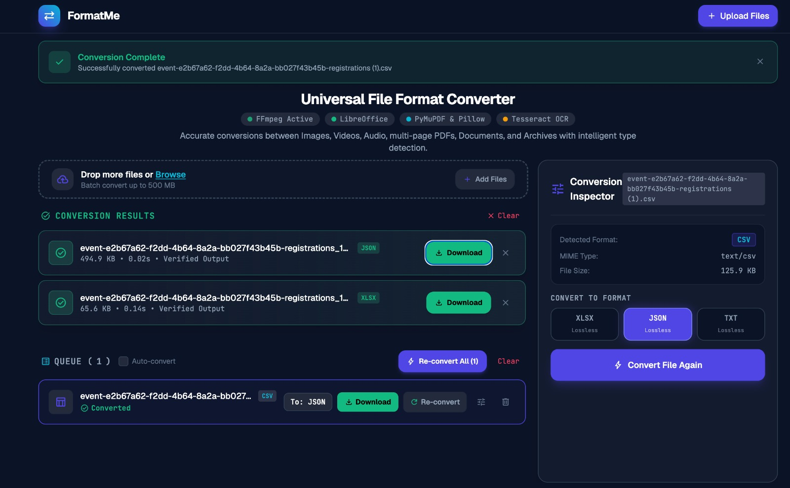

# FormatMe - Universal File Format Converter

> **An enterprise-grade, privacy-first universal file format converter powered by Flask, FFmpeg, PyMuPDF, and LibreOffice.**

[](https://www.python.org/)
[](https://flask.palletsprojects.com/)
[](https://ffmpeg.org/)
[](https://www.libreoffice.org/)
[](#architecture--security-safeguards)
[](LICENSE)

<br/>

<p align="center">
  
</p>

---

## Overview

**FormatMe** is a high-performance, full-stack media and document conversion engine. Built for technical users and enterprise teams requiring reliable format transformation without data leakage, FormatMe executes genuine transcodes and re-encodings locally—never simple extension renaming or cloud offloading.

The system combines automated binary signature detection (magic byte analysis) with an adaptive web interface. Users can inspect file metadata, tune granular compression and encoding parameters, batch-process heterogenous file queues, and convert between formats spanning Images, Multi-Page PDFs, Audio, Video, Office Documents, Structured Data, and Compressed Archives.

---

## Key Capabilities

- **Deep Binary Format Identification**: Accurately detects true underlying MIME types and formats via binary signatures (`%PDF-`, `RIFF`, `ftyp`, `PK\x03\x04`, `\x89PNG`, `7z\xBC\xAF\x27\x1C`), preventing mismatched pipelines or spoofed extensions.
- **Exhaustive Multi-Page PDF Handling**:
  - Convert entire multi-page documents into individual high-DPI images, packaged ZIP archives, or vertically stitched panoramic composites without dropped pages.
  - Merge arbitrary PDF documents in ordered sequence.
  - Unlock and decrypt password-protected PDFs directly in-browser.
  - Extract text and perform optical character recognition (OCR) on scanned documents.
- **High-Fidelity Audio & Video Transcoding**:
  - Two-pass palette generation for video-to-animated-GIF and GIF-to-video conversions.
  - Video sound extraction to lossless and compressed audio formats (MP3, WAV, AAC, FLAC, OGG, Opus).
  - Audio-to-video synthesis with solid backdrop generation.
  - Fine-grained controls for Constant Rate Factor (CRF), audio bitrates, and resolution scaling.
- **Headless Office Document Rendering**:
  - Convert DOCX, ODT, RTF, Markdown, and HTML documents with precise typography and table preservation.
- **Bidirectional Structured Data Translation**:
  - Convert effortlessly between tabular CSV, JSON structures, and Microsoft Excel (XLSX) workbooks.
- **Universal Archive Packaging & Unpacking**:
  - Cross-convert between `ZIP`, `TAR`, `TAR.GZ`, `TAR.BZ2`, `TAR.XZ`, `7Z`, and `RAR` with configurable compression ratios.
- **Adaptive Conversion Inspector**:
  - Contextual parameters appear dynamically per file type (CRF sliders, DPI selectors, compression algorithms, multi-page layout choices).
  - Multi-file bulk transformations: "Apply to All", "Combine Images into PDF", and "Batch Convert Queue".

---

## Supported Format Matrix

| Category | Input Formats | Target Formats | Engine & Highlights |
| :--- | :--- | :--- | :--- |
| **Images** | `PNG`, `JPEG`, `WebP`, `GIF`, `BMP`, `TIFF`, `ICO`, `AVIF`, `HEIC` | `PNG`, `JPEG`, `WebP`, `GIF`, `BMP`, `TIFF`, `ICO`, `AVIF`, `PDF`, `TXT` (OCR), `MP4`, `WebM` | Pillow, pillow-heif, EasyOCR. Preserves alpha channels, EXIF orientation, and animation frames. |
| **PDF Documents** | `PDF` *(Standard, Scanned, or Password-Encrypted)* | `PNG`, `JPEG`, `WebP`, `TIFF`, `TXT`, `HTML`, `PDF` *(Merged/Decrypted)* | PyMuPDF & pypdf. Every page rendered; choice of single composite image, discrete pages, or ZIP bundle. |
| **Video** | `MP4`, `MOV`, `AVI`, `MKV`, `WebM`, `WMV`, `3GP` | `MP4`, `WebM`, `MKV`, `AVI`, `MOV`, `GIF`, `MP3`, `WAV`, `AAC`, `FLAC`, `OGG` | FFmpeg. H.264, VP9, and ProRes pipelines; two-pass palettegen GIF export; subtitle/audio stream management. |
| **Audio** | `MP3`, `WAV`, `AAC`, `M4A`, `FLAC`, `OGG`, `Opus`, `AIFF`, `WMA` | `MP3`, `WAV`, `AAC`, `M4A`, `FLAC`, `OGG`, `Opus`, `AIFF`, `MP4`, `WebM`, `MKV` | FFmpeg. Variable/constant bitrates (64k–320k), lossless PCM, and audio-to-video black-canvas synthesis. |
| **Documents** | `DOCX`, `ODT`, `RTF`, `Markdown (.md)`, `HTML`, `TXT` | `PDF`, `DOCX`, `ODT`, `HTML`, `TXT`, `MD` | LibreOffice Headless & Python-Docx. Full pagination, header/footer, and stylesheet fidelity. |
| **Data & Spreadsheets** | `CSV`, `XLSX`, `JSON` | `CSV`, `XLSX`, `JSON`, `TXT` | OpenPyXL & pandas. Native header handling, Unicode UTF-8 enforcement, and sheet normalization. |
| **Archives** | `ZIP`, `TAR`, `TAR.GZ`, `TAR.BZ2`, `TAR.XZ`, `7Z`, `RAR`, `GZ`, `BZ2`, `XZ` | `ZIP`, `TAR`, `TAR.GZ`, `TAR.BZ2`, `TAR.XZ`, `7Z` | Zipfile, Tarfile, and 7-Zip CLI. Safe directory extraction, traversal defenses, and configurable compression levels. |

---

## System Requirements & External Engines

FormatMe requires Python 3.10+ along with standard system utilities for media transcoding and headless document compilation.

### Linux (Ubuntu / Debian)
```bash
sudo apt update
sudo apt install -y ffmpeg libreoffice p7zip-full
```

### Linux (Fedora / RHEL)
```bash
sudo dnf install -y ffmpeg libreoffice p7zip p7zip-plugins
```

### macOS (Homebrew)
```bash
brew update
brew install ffmpeg libreoffice p7zip
```

### Windows
- Install [FFmpeg](https://ffmpeg.org/download.html) and append its `bin` folder to your System `PATH`.
- Install [LibreOffice](https://www.libreoffice.org/download/download/) and verify `soffice` is accessible from the command line.
- Install [7-Zip](https://www.7-zip.org/) and add `7z.exe` to your `PATH`.

---

## Installation & Setup

### 1. Clone & Prepare Environment
```bash
# Clone repository
git clone https://github.com/your-username/FormatMe.git
cd FormatMe

# Create dedicated virtual environment
python3 -m venv .venv
source .venv/bin/activate  # On Windows: .venv\Scripts\activate

# Install Python dependencies
pip install --upgrade pip
pip install -r requirements.txt
```

### 2. Launch Development Server
```bash
python app.py
```
Open your browser and navigate to:
```
http://127.0.0.1:5000
```

### 3. Production Deployment (Gunicorn)
For concurrent production workloads:
```bash
pip install gunicorn
gunicorn --workers 4 --threads 2 --bind 0.0.0.0:5000 --timeout 120 app:app
```

---

## Architecture & Security Safeguards

FormatMe enforces strict defense-in-depth principles to ensure server stability and prevent file-handling exploits:

```
[Incoming File]
      │
      ▼
┌─────────────────────────────────┐
│ Binary Signature Verification   │ ◄── Inspects true magic bytes; disregards forged extensions
└─────────────────────────────────┘
      │
      ▼
┌─────────────────────────────────┐
│ Path Sanitization & Isolation   │ ◄── Sanitizes filenames with secure_filename; isolated UUID storage
└─────────────────────────────────┘
      │
      ▼
┌─────────────────────────────────┐
│ Resource Bounds Enforcement     │ ◄── 500 MB upload ceiling, zip-bomb traversal protection, memory check
└─────────────────────────────────┘
      │
      ▼
┌─────────────────────────────────┐
│ Native Modular Engine Dispatch  │ ◄── Targeted pipelines (FFmpeg / PyMuPDF / LibreOffice / Pillow / 7z)
└─────────────────────────────────┘
```

- **True Signature Inspection**: Validates magic byte signatures prior to pipeline selection, neutralizing file extension spoofing attacks.
- **Directory Traversal Defense**: All input filenames are scrubbed with `werkzeug.utils.secure_filename`. Archive unpackers inspect all entries to block `../` path injection vulnerabilities.
- **Decompression Bomb Protection**: Archive extraction caps extraction limits at 1,000 files and 500 MB uncompressed size.
- **Safe Multi-Page Rendering Safeguards**: High-page-count PDFs are checked for pixel and memory bounds before long-canvas assembly. If dimensions exceed safety thresholds (32,000 px height / 100 MP), the engine falls back to generating a cleanly organized ZIP archive.

---

## REST API Documentation

FormatMe exposes an intuitive RESTful API that can be integrated into external workflows or automation pipelines.

### 1. Detect File Format
```http
POST /api/detect
Content-Type: multipart/form-data
```
**Request:** Upload a file under the `file` form key.

**Response:**
```json
{
  "temp_id": "9a38f7d0a21...",
  "original_name": "document.pdf",
  "detected_format": "pdf",
  "category": "pdf",
  "size": 1048576,
  "formatted_size": "1.0 MB",
  "mime_type": "application/pdf",
  "available_conversions": ["png", "jpeg", "webp", "tiff", "txt", "html"],
  "settings_schema": {
    "pdf_mode": {
      "type": "select",
      "label": "Multi-page Output Mode",
      "options": ["single_image", "separate_images", "zip"]
    }
  }
}
```

### 2. Execute Conversion
```http
POST /api/convert
Content-Type: application/json
```
**Request:**
```json
{
  "temp_id": "9a38f7d0a21...",
  "target_format": "docx",
  "options": {
    "quality": 90,
    "compression_level": "standard"
  }
}
```

**Response:**
```json
{
  "success": true,
  "download_url": "/api/download/9a38f7d0a21_document_converted.docx",
  "output_filename": "9a38f7d0a21_document_converted.docx",
  "output_size": 524288,
  "formatted_size": "512 KB",
  "target_format": "docx"
}
```

### 3. Download Converted Artifact
```http
GET /api/download/<filename>
```
Streams the converted file directly to the client as an attachment.

---

## License

This project is licensed under the [MIT License](LICENSE) — see the LICENSE file for details.
